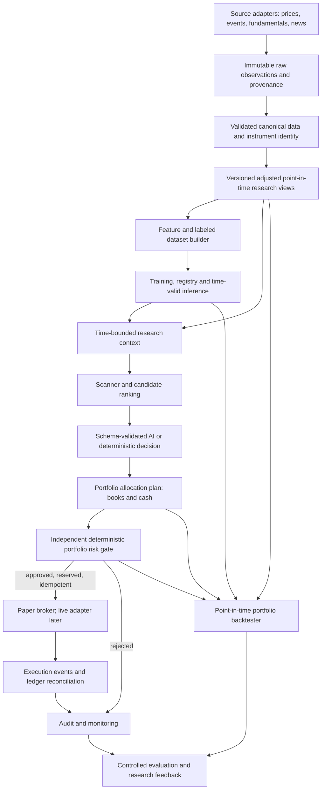

# Autonomous AI architecture review

**Review date:** 2026-11-03  
**Reviewed checkout:** `phase-6-usability`, including its uncommitted usability work  
**Scope:** Architecture analysis. No production implementation is authorized by this document.

**Historical snapshot:** Capability statements below describe the 2026-11-03
checkout. Phase 6A market-data foundations and Phase 7A/7B synthetic research
infrastructure were added later; see `docs/PROJECT_STATUS.md` for current
capabilities and unresolved real-data work.

## 1. Executive assessment

**Verdict: YES, BUT CHANGE THE MARKET-DATA AND RESEARCH BOUNDARIES BEFORE BUILDING ML.** Phases 1–5 supply useful accounting, local security, data validation, independent proposed-trade risk checks, and a deterministic simulation harness. They do not yet form an autonomous decision system. The current daily-price table and `Bar` require a source-provided `previous_close`, assume one EQ symbol/series identity, and mix source observation with the canonical research bar. These assumptions will obstruct Upstox candles, corporate-action-aware research, and point-in-time experiments. Extend them through migrations and adapters; do not rewrite the ledger or discard the ZIP importer.

The scientific objective is to measure whether ML and AI add value after costs and risk. Negative results must remain reportable. Real broker execution is a later, separately authorized capability, never a direct LLM tool.

**Status convention:** Sections 2–3 describe code that exists. All designs from Section 8 onward are **FUTURE requirements** unless explicitly identified as existing. Describing a component here neither authorizes its implementation nor establishes that its signal is useful. In particular, the original `PROJECT_BRIEF.md` limits LLMs to research and forbids independent trade decisions; the newly clarified goal allows AI to *propose* structured allocation decisions subject to hard risk. That is a policy change to record in a new ADR and explicitly approve before implementing an AI decision layer.

## 2. Current architecture reconstructed from code

The project is a local modular monolith: FastAPI routes delegate to services; SQLAlchemy models and Alembic own SQLite persistence; React/TypeScript consumes authenticated `/api` routes through a loopback-only Vite development proxy. Evidence: `backend/app/api/`, `backend/app/services/`, `backend/app/db/`, `backend/alembic/`, `frontend/src/`, `frontend/vite.config.ts`.

`LedgerService` writes deposits, withdrawals, buys and sells with integer paise. Each buy creates a FIFO lot; each sell atomically records lot matches, realised P&L and positive Profit Vault credit. Read services supply book-cost summary, valuation, realised P&L, CSV exports and price coverage. The ledger is append-only, but reversal/void entries are not implemented. The manual ledger API records completed events without passing the proposed-trade risk validator; this is an accounting intake, not an execution channel. Evidence: `backend/app/modules/portfolio/ledger_service.py`, `backend/app/db/models/ledger.py`, `backend/app/api/routes/portfolio.py`.

`RiskValidator` is pure and receives a proposed trade, snapshot and limits. It rejects missing/invalid inputs and returns rejection reasons. It covers single-trade cash, order size, symbol allocation, stop exposure, daily realised loss and held quantity. It does not validate a portfolio reallocation batch, sector exposure, aggregate leverage, drawdown, data freshness, market hours or an execution lifecycle. The API only validates and does not create an order. Evidence: `backend/app/modules/risk/validator.py`, `backend/app/api/routes/risk.py`, `backend/app/services/risk_service.py`.

The strict ZIP importer reads local files in memory, validates one observed NSE profile, stores only EQ rows, deduplicates by archive hash and instrument/date, and rejects conflicting ISIN or price in one transaction. An identical instrument/date row in a different file is counted as skipped, not preserved as a second independent observation. `Instrument` is unique by `(symbol, series)`; `DailyPrice` has integer-paise OHLC, required `previous_close_paise`, volume, `price_basis='unadjusted'`, and a required `ImportBatch` foreign key. `ImportBatch` is file-oriented provenance. Valuation uses a close on or before the requested date with a configurable calendar-day staleness limit. Evidence: `backend/app/services/price_import_service.py`, `backend/app/services/price_read_service.py`, `backend/app/db/models/prices.py`.

The backtester loads EQ bars from an explicitly named SQLite file with `mode=ro` and `query_only=ON`, creates an in-memory SQLite ledger, gives strategies a copied history through the decision date, queues next-open intents, calls the risk validator for normal simulated fills, models costs/slippage/stops, and writes JSON trial records. It has buy-and-hold and momentum baselines, constrained/unconstrained equal-weight and cash comparisons, and consecutive windows. The intentionally unconstrained benchmark bypasses risk **only as a named research counterfactual**; no production path may copy that bypass. The unverified placeholder cost profile blocks stored-price runs. Evidence: `backend/app/modules/backtest/{data,engine,strategies,report,run,costs}.py` and `backend/app/cli.py`.

Authentication uses a single environment bearer token with constant-time byte comparison, except public health. Backup, guarded restore and read-only integrity checks exist. The frontend has ledger forms, retryable idempotent submission, valuation, price coverage, risk status, realised P&L and CSV links. Several engine cards remain placeholders. Evidence: `backend/app/core/auth.py`, `backend/app/services/{backup_service,integrity_service}.py`, `frontend/src/App.tsx`, `frontend/src/components/`.

## 3. What is already good

| Component | Classification | Evidence and reason |
| --- | --- | --- |
| Modular monolith and route/service separation | **KEEP / GOOD AS-IS** | Small, independently testable modules; no demonstrated need for microservices. |
| Integer-paise FIFO ledger and atomic sell | **KEEP / GOOD BUT NEEDS EXTENSION** | Reliable accounting core; later needs correction events and book ownership. |
| Pure, fail-closed risk validator | **KEEP / GOOD BUT NEEDS EXTENSION** | Independent of AI and brokers; lacks portfolio-batch and execution-state rules. |
| Strict local ZIP importer and conflict refusal | **KEEP / GOOD AS-IS** for this profile | Preserves an auditable NSE observation path; do not weaken its exact-header rule for other providers. |
| Provenance, read-only valuation and integrity | **KEEP / GOOD BUT NEEDS EXTENSION** | Useful source and discrepancy trail; future quality/adjustment lineage needs richer records. |
| Read-only backtest source, bounded view and baseline comparisons | **KEEP / GOOD BUT NEEDS EXTENSION** | Protects current daily-bar simulation; prediction timestamps and broader counterfactuals are absent. |
| Backup, local auth and idempotent write API | **KEEP / GOOD BUT NEEDS EXTENSION** | Suitable for one local operator; not a cloud/mobile or broker identity model. |
| React dashboard and usability forms | **KEEP / GOOD BUT NEEDS EXTENSION** | Useful operator surface; not a research, decision-review or execution console yet. |

## 4. What needs extension

The data layer needs provider-neutral source records, stable instrument identity, provider mapping with validity dates, canonical daily bars, explicit availability timestamps, and later adjusted research views. The ledger needs append-only correction semantics and strategy/book attribution. Risk needs portfolio-level, pre-execution checks and a persisted decision-to-execution handoff. Backtesting needs point-in-time feature and prediction inputs, independent benchmark replays, and experiment lineage. Auth and storage can stay local while those boundaries are built.

## 5. What should eventually be refactored

Refactor the current `DailyPrice`/`Bar` contract so `previous_close_paise` is not required merely because the ZIP has `PrvsClsgPric`. Refactor file-shaped `ImportBatch` into a general ingestion-run concept while retaining historical ZIP batches. Move from symbol-only joins to stable instrument IDs and temporal symbol/provider aliases. Extend the single-trade risk API with an atomic portfolio-plan validator, rather than replacing its existing rules. Evolve JSON trial files into a searchable experiment index when experiment volume justifies it. SQLite can remain the operational ledger; measured data size and query needs should determine whether large research datasets need another local format or database.

## 6. Wrong direction or unnecessary work

**Wrong if generalized:** treating `previous_close` from one source as a universal mandatory field; silently mapping a new provider's float JSON prices to paise without decimal-safe parsing and reconciliation; assuming current symbols define a historical universe; treating the unconstrained research benchmark as an execution mode; treating `gross = net + observed drag` as an independently simulated cost-free return. The last is currently labelled an attribution estimate in `backend/app/modules/backtest/report.py` and must remain labelled that way.

**Unnecessary now:** microservices, Kubernetes, cloud deployment, a full-universe LLM scanner, high-frequency ingestion, a live broker, and more hand-written strategies before research data is trustworthy. The README and status contain some historical phase-era statements (for example old no-auth limitations in ADRs); treat dated ADRs as decisions at the time, and keep current capability claims in `PROJECT_STATUS.md` accurate.

## 7. Missing components

The code contains no provider abstraction or Upstox adapter, corporate-action/event store, adjusted dataset, point-in-time fundamentals/news store, feature pipeline, model training/registry/inference, AI context/decision interface, opportunity scanner, portfolio allocator, strategy books, paper broker, live broker, decision audit log, scheduler, or model/decision/operational monitoring. Logs and a read-only integrity command do exist. There is no production order object. Existing engine status cards are placeholders. These are planned modules, not implicit capabilities.

**Placement of the requested future components:**

| Component | Place in the modular monolith | Present state |
| --- | --- | --- |
| 1. Market data | `data` provider adapters, raw observations and canonical store | ZIP-only importer and daily table; extend |
| 2. Corporate actions | `data/actions` and versioned adjustment views | Missing |
| 3. Features | `research/features` over point-in-time datasets | Missing |
| 4. ML training | Offline `research/training` pipeline | Missing |
| 5. Model registry | Local immutable research artifacts/manifests | Missing |
| 6. Inference | Versioned `research/predictions` interface | Missing |
| 7. News/sentiment | `data/news` ingestion plus versioned research extraction | Missing |
| 8. Fundamentals | `data/fundamentals` with publication-time history | Missing |
| 9. Market regime | Versioned `research/regime` feature/model | Missing |
| 10. Opportunity scanner | `decisions/scanner`, before expensive AI | Missing |
| 11. Candidate ranking | `decisions/ranking`, deterministic baseline and scored alternatives | Missing |
| 12. AI research | Bounded `ai/context` and evidence extraction | Missing |
| 13. AI comparative decisions | Schema-validated `ai/decisions`, no execution access | Missing |
| 14. Portfolio allocation | `decisions/allocation` plan over positions and cash | Missing |
| 15. Capital books | Additive ledger ownership and aggregate views | Missing |
| 16. Portfolio risk | Extend independent `modules/risk` to whole plans | Single-trade validator exists |
| 17. Cash allocation | Explicit candidate and book-level reserve | Only account cash/vault exists |
| 18. Paper broker | `execution/paper` behind narrow order interface | Missing |
| 19. Live broker | Later `execution/adapters`, separately authorized | Missing |
| 20. Rotation audit | Immutable decision/plan/risk/execution links | Missing |
| 21. Portfolio backtester | Extend `modules/backtest` to plans and books | Single-book daily simulator exists |
| 22. Scheduler | Local orchestration for ingest/inference/paper tasks | Missing |
| 23. Monitoring | Data quality, risk, execution and model-drift alerts | Logs/integrity only; extend |

## 8. Target architecture diagram

The risk gate is the only route from a proposed allocation to execution. AI and ML have no broker credentials or direct write access to the order channel. **FUTURE:** market-wide observations enter alongside stock data; sizing and operational-state checks sit between candidate decisions and risk approval. The diagram omits those internal substeps for readability.

## 9. Market-data architecture

Use provider adapters that return immutable source observations plus source ID, instrument key, retrieval time, exchange timestamp, payload hash/version, and license/terms metadata. Normalize via shared Decimal-to-paise validation into a canonical OHLCV record. Keep raw observations, including conflicting ones; never overwrite or fabricate a consensus. Reconcile overlaps explicitly against the existing NSE ZIP bars. A conflict is a review state, not an automatic preference for either source. Coverage, missing sessions, stale bars, duplicate keys and identity ambiguity must be visible before research use.

**FUTURE market-wide intelligence:** index/sector OHLCV (for example sourced NIFTY or SENSEX series), breadth and advance/decline, liquidity/volume, volatility and correlations should be eligible source types, subject to rights and availability. Macro/rates and institutional-flow data such as FII/DII may be researched if their timing and legal source can be established; none is mandatory merely because it is listed. Keep the same chain as equities: immutable raw observation → point-in-time normalized series → versioned market/sector/regime feature → model, scanner and bounded AI context. Each value needs event time and first usable time. A post-close breadth statistic cannot influence a decision at that day's open. A changed source value or late correction should invalidate dependent derived datasets and pending decisions, while preserving what was originally known and audited.

`ImportBatch` remains the provenance record for the present ZIP importer. A future ingestion-run/source-observation design should represent API requests as well as files. A canonical bar may reference a selected source observation and selection policy. Data hashes in backtest runs should also identify the dataset and adjustment version.

**FUTURE data-quality observability:** monitor expected exchange sessions, duplicate/conflicting observations, zero/impossible OHLC, volume anomalies, clock/timezone errors, stale feeds, provider revision, identity ambiguity, corporate-action coverage and delayed news/fundamental intake. Give each affected dataset or instrument a quality state and lineage, not just a warning string. Critical defects propagate to `RESEARCH_BLOCKED`, `MODEL_INPUT_INVALID` or `DECISION_BLOCKED`; AI cannot fill unknown values with an explanation and proceed. A partial outage may block only affected instruments if unaffected aggregate risk state remains trustworthy. Alert on schema or source-distribution changes and retain incident history.

For `previous_close`, retain the ZIP-provided value as a **source observation**, nullable for a provider that does not send it. A canonical previous close may be derived only from the last valid prior trading-session close under a declared calendar, coverage and adjustment policy; the first bar or a gap can remain unknown. Never write that derived value back as if Upstox supplied it. The existing mismatch guard must compare two independently sourced observations; comparing a derived previous close to the very prior close used to derive it is tautological and cannot detect an action. Use explicit corporate-action data and cross-source checks for that purpose.

## 10. Historical versus intraday architecture

Retain `daily_prices` for the currently supported EOD contract. A later intraday-candle store should have instrument ID, UTC start/end timestamps, interval, exchange/session calendar, provider, version and quality status; its key is not merely instrument/date. Tick or real-time events need a distinct append-only stream and clock/sequence semantics. Daily bars may be produced from intraday data only through an explicit, versioned aggregation rule. Do not stretch the EOD table or its `previous_close` rule to accommodate high-frequency data. Research APIs should ask for a declared frequency and as-of time.

## 11. Corporate-action architecture

Add an immutable, sourced action record with instrument ID, event type, announcement/publication time, ex-date, record date, effective terms, source revision and review status. Build separate versioned adjustment factors and adjusted research views; raw OHLCV must never change. Distinguish split/bonus quantity and price effects from cash dividends and ticker/ISIN changes. Validate action timing before a backtest uses an adjusted view. Existing previous-close mismatch detection is a useful **flag**, not a corporate-action classifier; it can miss actions and can flag ordinary data disagreements. Keep stored-price backtests stopped or excluded on unresolved affected dates.

## 12. Feature/dataset architecture

Features need `instrument_id`, horizon, event time, **available-at time**, calculation code version, input dataset/adjustment versions and missingness flags. Market-wide and cross-sectional features follow the same rule and carry the universe and constituent set known at the cutoff. Labels are built separately from future outcomes and never supplied to inference. Dataset manifests must freeze universe membership as known then, joins, cutoff times, corporate-action policy, delisted securities, quality exclusions and hashes. A historical universe must explicitly represent listings, delistings, renames, suspensions, series changes and eligibility rules; today's listed symbols cannot stand in for the past. A price dated Monday is not automatically known at Monday's open. Fundamentals and news need publication and ingestion timestamps; restated accounts must not replace what was available historically. Revisions to upstream sources mark dependent features/labels stale and require rebuilding under a new dataset version; never rewrite the original decision's input snapshot.

## 13. ML training architecture

Use a reproducible local pipeline: dataset manifest → feature/label build → chronological training/validation/test splits with horizon-appropriate embargo → walk-forward training → cost-aware portfolio evaluation → registration decision. Keep distinct model families/horizons only when justified by data and tests. Hyperparameter trials, failed models and baselines must be recorded. Measure **prediction quality** (for example calibration, error, rank quality or directional precision where applicable) separately from **portfolio value** (net return, risk-adjusted return, drawdown, costs, turnover, exposure and capacity). A model with high accuracy may lose money; modest accuracy may still add value through sizing or ranking. Prediction metrics alone never qualify a model for capital deployment. Train only on approved point-in-time datasets; the current five-day sample and unadjusted history cannot support model claims. No ML library needs adding during this review.

## 14. Model registry/versioning architecture

Start with a local immutable model manifest and artifact hash: model ID/version, family/horizon, code revision, feature schema/version, dataset and label hashes, train/validation/test windows, hyperparameters, calibration, metrics, cost assumptions, approval status and dependency lock. **FUTURE lifecycle:** `candidate` → `research-approved` → `paper-approved` → `shadow-approved` → `live-approved`, with separate `degraded`, `suspended`, `retired` and `rejected` outcomes. These are governance states, not automatic deployment commands; each promotion needs evidence and an operator authorization for critical transitions. Monitor feature/prediction drift, calibration, uncertainty, missing/stale inputs, regime changes, realised performance versus baseline, excessive risk rejection or turnover, and artifact/schema integrity. A prior approval expires or is reviewable; degradation triggers alert, investigation, possible suspension and controlled revalidation, **never automatic retrain-and-redeploy**. Never replace an artifact under an existing version. A simple manifest is enough until experiment volume demands a registry service.

## 15. Prediction/inference architecture

A prediction is structured data: stable instrument ID, `generated_at`, `data_cutoff`, `valid_from`, `expires_at`, decision horizon, expected return/downside, calibrated probability or confidence (with definition), uncertainty, model/feature/dataset versions and quality status. These times have different meanings: generation does not make a prediction valid before its inputs arrived, and a long-term horizon does not justify indefinite use after an earnings or corporate-action event. It is an input to decisions, never a broker instruction. Historical replay may consume a prediction only when its **actual or reproducibly simulated availability time** precedes the decision cutoff; a retrospectively generated score must not masquerade as a historical live forecast. Missing/stale predictions are explicit.

## 16. News/sentiment architecture

Ingest licensed or authorized sources with source URL/ID, publication time, first-seen time, correction history, entity mapping and content hash. Store evidence references and limited permitted excerpts rather than indiscriminate full-text copies. Extract sentiment and event type with a versioned process; the score is uncertain evidence, not a trade decision. Historical evaluation uses first-seen/available-at time, not only an article's displayed date. Do not send private holdings or credentials to an external AI service unless separately approved and necessary.

## 17. AI decision-agent architecture

A context builder supplies a bounded, timestamped, structured snapshot: candidates and alternatives, model predictions, market-wide regime/breadth/sector context, fundamentals/news references, costs, portfolio/books/cash, risk limits and data-quality flags. Each market-wide value must pass the same available-at cutoff as a stock price. The LLM returns a schema-validated proposal with evidence, contradictions, uncertainty, proposed sizing, `generated_at`, `data_cutoff`, `valid_from`, `expires_at`, decision horizon and prompt/policy/schema versions. Reject unknown instruments, stale context or response, malformed output, unsupported actions and ungrounded quantities before allocation/risk. The LLM receives no database write capability, raw token, broker credential, arbitrary code execution, or unrestricted network/database tool. Free-form rationale is recorded for review but is not the machine instruction.

**FUTURE machine semantics:** `KEEP` means retain an existing position under its book's current thesis; `WAIT` defers a specific candidate/plan pending new evidence or a time trigger; `NO_ACTION` means this cycle produced no executable proposal and says nothing about a long-term thesis; `MOVE_TO_CASH` is an explicit, linked reduction/exit allocation with no replacement; `REJECTED_BY_RISK` is the downstream risk outcome, never an AI action. Avoid `HOLD` as an ambiguous machine value; it can be a display synonym for `KEEP` only when that meaning is explicit. `INSUFFICIENT_CONFIDENCE` and `DATA_QUALITY_BLOCK` are structured abstention reasons, not forced trade directions. Preserve per-source supporting and contradicting signals, their versions/timestamps, confidence quality, uncertainty and disagreement; no consensus is required. AI may propose a size but never set risk limits or treat a high directional probability as permission for a large allocation.

**FUTURE AI operating contract:** record request/response times, provider/model/API version, prompt/template/policy version, input and output hashes, token usage, estimated monetary cost, latency, timeout/retry count, rate limiting, schema result and expiry check. Decide whether expected incremental decision value justifies an AI call after cheap screening and quant ranking; intraday use needs a measured latency budget. Missing provider, timeout, malformed response, unknown symbol, stale evidence, low confidence, constraint conflict or changed provider behavior defaults to no new AI-assisted risk. A preapproved, versioned deterministic fallback may choose `KEEP`, `WAIT`, `NO_ACTION` or a separately risk-checked baseline, depending on the book; it must never guess or disable risk. Retries require bounded cost and idempotent decision identity. Measure AI trading value **net of** API cost, delay and failures.

## 18. Opportunity-scanning architecture

Run deterministic eligibility/liquidity and quality filters over a time-valid universe, then inexpensive quantitative screening and inference. Market, sector, breadth, correlation and liquidity context may change eligibility or scores only when available before the decision cutoff. Only a bounded candidate set receives deeper fundamentals/news research or AI comparison. Record rejected candidates and reasons to measure coverage and missed opportunities. A scanner must include existing holdings and cash as candidates; otherwise it cannot judge whether to keep a position.

## 19. Candidate-ranking architecture

Represent each candidate with expected return/downside, uncertainty, horizon, liquidity, costs, volatility/correlation, sector and regime fit, and portfolio impact. Rank on an explicitly versioned objective after estimated costs and risk. Calibrate scores within a horizon; do not compare raw confidence numbers from different models as though equivalent. Retain deterministic ranking and equal-weight baselines for AI evaluation. Screening/ranking determines *direction and relative priority*; the allocation stage determines *capital size*.

## 20. Dynamic portfolio reallocation architecture

Represent a rotation as **one plan** with linked source reduction, destination increase or cash allocation, expected net improvement, estimated switching costs, uncertainty penalty, concentration change, and rationale. A configurable threshold determines whether switching beats `KEEP`; no production threshold is set in this review. Evaluate partial fills, fees and reservation before the plan is approved. If an exit is justified but no replacement clears the threshold, allocate to cash. Preserve the plan even when rejected so later analysis can explain why no trade occurred.

**FUTURE allocation objective:** balance expected *net* return with downside, calibrated uncertainty, drawdown, volatility, liquidity, correlation/factor and sector concentration, turnover/switching cost, book/horizon budgets, cash reserve and existing exposure. Directional probability is one input, not a size formula. A separate sizing step produces a proposed quantity using those inputs; AI may suggest it, while deterministic risk retains final authority to approve or reject. If risk feedback calls for a smaller quantity, the allocator creates a **new immutable plan version** and submits it for fresh validation; risk never mutates an approved plan in place. Compare simple equal weight, deterministic rank sizing, risk-adjusted sizing, constrained optimization and AI allocation on identical data and costs. Do not select an optimizer or arbitrary threshold now. A portfolio of several banks/NBFCs can be a concentrated financial-sector bet despite small individual weights; aggregate risk should eventually include sector/industry, common event, market beta, correlated factor and overlapping-book exposure.

## 21. Strategy-specific capital architecture

The present ledger is a single account keyed by symbol; lots, transactions, cash and Profit Vault entries have no book/strategy ownership. This does **not** require a complete rewrite, but multiple horizons need additive `book_id`/allocation-event relationships, explicit cash transfers, lot ownership, and aggregate-plus-book risk snapshots. Migrate existing events into a default book, retain immutable original events, and test cross-book transfers and FIFO policy. A swing signal cannot silently sell a long-term lot. The overall portfolio risk gate still sees aggregate exposure and the global Profit Vault rule.

## 22. Cash-allocation architecture

Model cash as an explicit allocation option per book plus reserve and virtual Profit Vault constraints. Separate operational cash from deployable cash; the current vault is a virtual reserve, not segregated broker funds. Allocation plans may target cash without fabricating a replacement asset. Portfolio optimization must account for settlement/available cash, fees and partial fills when those capabilities are introduced. Evaluate an unused-cash decision against a cash baseline, relevant market/strategy benchmark and, when sourced appropriately, a realistic low-risk cash-equivalent reference; do not hard-code a yield or instrument now.

## 23. Deterministic risk boundary

Keep the current pure validator as the starting point, then introduce a separate portfolio-plan risk service with all-reasons rejection, versioned settings, a frozen snapshot and data-quality/market-state inputs. It must validate combined post-plan exposure, sector/industry/factor and book limits, correlated holdings, liquidity, stale data, drawdown/weekly loss, duplicate intents, hours, order state and kill switch. An approval must be bound to the exact immutable plan, market/portfolio snapshot and policy version; include `valid_from` and `expires_at`, then recheck immediately before paper/live submission. Exchange trading calendar, authoritative clock and actual listener/market state matter; a local date string alone is insufficient for intraday execution. AI cannot alter limits or call a broker. The current validation-only endpoint is **not** that execution gate. Manual historical ledger POSTs remain distinct accounting intake and do not validate already-completed broker events retroactively. The current historical buy intake deliberately does not check available cash; negative final cash is flagged by integrity checks rather than pre-trade risk.

## 24. Paper/live execution architecture

First add a paper broker behind a narrow execution interface. Persist order intent, risk decision, reservation, submission, acknowledgement, fill, rejection, cancellation and reconciliation events with idempotency and recovery after process restart. Execution assumptions should become more realistic in stages: volume participation first, then spread/auction/order-type constraints, partial fills and measured slippage/impact when data supports them. Do not assume unlimited fills at bar prices or build a sophisticated impact model without evidence. Test capacity across capital sizes, order size/liquidity and turnover; performance at ₹10,000 cannot be presumed to scale to larger capital. Partial fills and multi-leg rotations must never assume both legs execute. A later live broker adapter uses separate credentials/permissions, a kill switch, limits, reconciliation and staged approval. The accounting ledger should ingest confirmed fills, not treat an AI decision as a completed trade. No execution code is present now.

### Future operational safety modes

The execution controller should persist an operator-visible state: `NORMAL`, `BLOCK_NEW_RISK`, `REDUCE_ONLY`, `CANCEL_PENDING`, or `FULL_KILL`. These are **FUTURE** policy states, not current API switches. The default when required state cannot be trusted is `BLOCK_NEW_RISK`. `REDUCE_ONLY` permits only a separately validated reduction with known holdings, open orders, market state and broker reachability; it does not mean “sell blindly.” `CANCEL_PENDING` attempts idempotent cancellation and verifies broker state. `FULL_KILL` stops new submissions and invokes cancellation/reconciliation; it does **not** assume forced liquidation is safe during an outage. State changes, reasons, authorized operator and recovery checks are immutable audit events.

| Failure or uncertainty | Initial future response; recovery condition |
| --- | --- |
| Market-data outage, stale feed or partial coverage | Block new risk for affected instruments or books; escalate portfolio-wide if aggregate exposure cannot be trusted. Resume after freshness, identity and coverage checks. |
| Corrupted research data, unexpected schema, missing model artifact or model-input mismatch | Mark dependent predictions/decisions invalid and block their new risk; rebuild/revalidate from versioned inputs. |
| AI outage, timeout, malformed response, rate limit or stale response | No new AI-assisted risk; use only a preapproved versioned fallback that still passes deterministic risk. |
| Broker API outage, unknown open order or reconciliation mismatch | Stop new submissions, reconcile broker order/fill state, cancel pending orders when possible; do not duplicate uncertain orders. |
| Partial fill or rotation with one leg filled | Recompute cash/holdings/exposure and revalidate the remaining plan; do not assume the second leg or an immediate replacement. |
| Database failure or process crash/restart | No new submissions until durable order/risk state is recovered and reconciled with the broker; replay idempotently. |
| Clock/timezone disagreement, market halt, instrument suspension or extreme volatility | Block affected new risk; use an authoritative exchange calendar/time source and reviewed halt/volatility policy before resuming. |
| Risk state unknown, broken policy artifact or emergency operator stop | `FULL_KILL`/`CANCEL_PENDING` as applicable; do not promote a fallback to normal operation without explicit reconciliation and authorization. |

Scheduled scans and event-triggered reevaluation should eventually share the same versioned decision pipeline. Earnings, corporate actions, material announcements, sharp moves, stop triggers, volatility/regime changes, degrading model confidence and risk breaches can enqueue reevaluation. Debounce and deduplicate by event/decision ID; an event arriving late cannot rewrite a historical decision. No event bus or scheduler is required now.

### Future security and authority boundaries

Separate market-data, AI API, paper-broker and live-broker credentials and permissions. Research/ML and AI workers get only the minimum point-in-time data; they cannot read risk configuration secrets, live broker credentials or writable execution state. A paper broker cannot acquire live permissions by configuration accident. Only the deterministic risk/execution boundary can issue an approved, expiring order intent; only an authorized operator can change limits, promote a model/policy or clear a kill state. Manual interventions are auditable events, not edits to past decisions. A future remote/mobile deployment needs user identity, roles, secret isolation, encrypted transport/storage and least-privilege database permissions before network exposure.

The current app's loopback protection is for local operation only: `BACKEND_HOST` controls startup/docs checks in `backend/app/core/auth.py` and `backend/app/main.py`, while Uvicorn's actual `--host` is supplied separately. Before any network exposure, bind configuration and listener verification must become one authoritative boundary. This review does not change the current local setup.

## 25. Auditability/reproducibility design

Each decision record should link: decision ID and timestamp, context/data cutoff, source/feature/model versions, AI provider/model/template **and policy/schema/tool-access versions**, structured response, candidate set and rejected alternatives, supporting/contradicting evidence, portfolio/book snapshot, risk-policy version and result, plan, execution events, manual interventions, and eventual outcome. For rotation, include source/destination, released/reallocated cash, costs, expected improvement and portfolio impact. Store hashes or immutable references for large source artifacts; keep sensitive prompts/private data access-controlled. The operator should be able to reconstruct why a stock was selected or rejected, why a holding was reduced or cash chosen, what each risk rule returned, what actually filled and what happened later. An explanation is evidence, never permission to override an audit record.

**FUTURE external-AI reproducibility:** replay the *original recorded structured response* separately from regenerating a *new* response. Preserve provider/model/API configuration, template/system prompt, candidate representation, tool permissions, response schema, structured input hash, original response, timestamps and failure/latency metadata where retention terms allow. Exact regeneration may be impossible even with the same apparent prompt. A newer provider response must never silently replace the one used by a historical decision. Prompt, policy, schema or tool-access changes create new versioned research artifacts and experiment cohorts. A source correction can invalidate new decisions built on old data without rewriting what the old decision actually saw.

**FUTURE observability:** correlate source/quality incidents, feature availability, model drift/calibration, AI latency/cost/schema failures, decision abstentions, risk rejections, order/fill reconciliation and portfolio outcomes by run and decision ID. Alerts need accountable ownership and recovery evidence, not only dashboards. Track degraded performance against deterministic baselines without automatically retraining, changing limits or resuming suspended execution.

## 26. Backtesting and anti-look-ahead design

Keep the existing bounded `HistoryView` and next-open fill semantics. Extend the decision view to point-in-time prices, market-wide context, adjusted-data version, fundamentals, news, historical universe and predictions, each gated by **available-at**, not merely event date. Snapshot all inputs before a decision. Use negative-control leakage tests like the existing future-bar test. Handle listings, delistings, suspensions, missing bars, actions, holidays, costs, liquidity and partial fills. Vary capital size and liquidity assumptions to expose capacity limits rather than extrapolating one small-capital result. A historical AI response must be recorded or explicitly generated in a controlled historical experiment; today's LLM reading a reconstructed past with later facts is not a valid live-equivalent test. A decision, prediction and risk approval each require their own validity interval; an expired approval cannot authorize a later order.

## 27. Portfolio-level backtesting design

The simulation unit becomes a portfolio allocation plan across books and cash, with aggregate risk validation and linked execution outcomes. Compare buy-and-hold, deterministic baseline, model alone, deterministic ranking, AI filter, AI rotation, relevant market/strategy benchmark and cash using the **same** data cutoff, costs, slippage, universe and execution assumptions. A cash-equivalent benchmark may be added only with a reliable historical yield source and timing; it is not a prerequisite for the first research dataset. Keep the deliberately unconstrained benchmark isolated and clearly labelled. Report net return, annualised return only with sufficient history, risk-adjusted return, drawdown, volatility, turnover, costs, exposure, concentration/factor risk, holding period, win/loss, rotation counts and capital-capacity sensitivity. Replace attribution-only “gross return” with an independent cost-free replay if a true counterfactual gross result is needed.

## 28. AI/ML evaluation methodology

Pre-register the question and metric, freeze a holdout, and compare paired decisions over the same windows: deterministic baseline, quant model alone, quant plus fixed filter, quant plus AI filter, quant plus AI allocation. Report **predictive quality** (calibration, ranking/error and horizon-specific discrimination) separately from **decision value** (net portfolio return, drawdown, risk, turnover, costs, exposure, concentration and capacity). Track all trials, including failed ones, and report uncertainty and sample size. Decompose benefit into changed trade count, accepted/rejected signals, sizing, timing, abstentions, AI latency/failures/API cost and trading costs. If AI reduces trading, compare against a deterministic rule that reduces trading equally. Paper-forward results must remain separate from backtests. A result that AI worsens net performance is a valid finding.

## 29. Rotation evaluation methodology

Compare identical model/candidate inputs with rotation disabled, deterministic threshold rotation, and AI-assisted rotation. Report incremental net return, switching costs, turnover, drawdown, exposure, cash time, rejected plans and missed opportunities. Record the counterfactual `KEEP` or `MOVE_TO_CASH` result for every rotation. Test thresholds on training/validation periods and freeze them for holdout; do not tune them on the final test window.

### Future promotion and governance gates

No model, AI policy, sizing rule or allocation policy moves from a backtest directly to live capital. A proposed lifecycle is **research → historical/out-of-sample validation → paper replay → forward paper → shadow mode → small controlled live allocation → broader live allocation**. At each gate, preserve the exact artifact/policy versions, reviewer, decision, evidence and rollback/suspension conditions. The relevant evidence types are sample size, calibration where applicable, net out-of-sample performance against simple baselines, cost/slippage sensitivity, drawdown and turnover, regime stability, data-quality reliability, operational latency/failure/reconciliation, forward-paper behavior and risk-rule outcomes. Set no numerical promotion thresholds in this architecture review. Critical promotions and resumptions require operator authorization until a different governance model is separately justified and approved. Degraded models or AI policies can be suspended without automatically replacing themselves.

## 30. Revised development roadmap

1. **Close the present usability milestone:** inspect the uncommitted Phase 6 changes, manually exercise forms/reports on a disposable database, and have the user commit when satisfied. Design append-only correction/replay before substantial real ledger use.
2. **Data foundation before ML:** small Upstox pilot only after the user supplies a private Analytics Token; provider-neutral raw observations, stable/temporal identity, canonical daily bars, optional/derived previous-close semantics and overlap reconciliation. Preserve the ZIP importer. Verify access rights and actual coverage before scaling. Upstox documents V3 candle fields as timestamp/OHLC/volume/open interest, without previous close; its Analytics Token is read-only and includes historical-data access. See [V3 documentation](https://upstox.com/developer/api-documentation/v3/get-historical-candle-data/) and [Analytics Token](https://upstox.com/developer/api-documentation/analytics-token/). **No real API call or credential was used in this review.**
3. **Point-in-time research data:** corporate-action source and versioned adjustments, universe/delisting history, quality gates and an index benchmark. Verify broker delivery charges and golden examples; do not mark a placeholder cost profile verified.
4. **Move ML infrastructure earlier:** feature/label dataset manifests, chronological walk-forward harness, experiment tracking, model registry and structured prediction interface. Keep simple deterministic strategies as baselines; do not spend several phases on additional hand-written strategies first.
5. **Portfolio decision research:** candidate scanner/ranker, multiple capital books and cash, deterministic reallocation baseline, portfolio-plan risk validator and portfolio-level backtest.
6. **AI comparison:** bounded context builder, schema-validated decisions, audit records, controlled AI-versus-deterministic ablations. Use an external AI API only after privacy/cost decisions.
7. **Paper-forward operation:** paper broker, scheduler, alerting, execution reconciliation and monitoring, with independent risk rechecks and kill switch.
8. **Controlled live integration, then intraday:** only after sustained evidence and separate approval; define intraday data/execution rules before building intraday models. Cloud/mobile is an operational decision after local security and data needs are understood.

Each step has an evidence gate. The added market-wide, sizing, abstention, drift and AI-operations requirements **do not change the immediate data-first order**. They specify contracts and future promotion/monitoring gates; they do not justify implementing AI before a trustworthy point-in-time dataset. Scheduled and event-triggered reevaluation belong with later paper-forward orchestration. Do not infer that later phases will be valuable merely because their modules can be coded.

## 31. What we should build next

**Immediate next coding milestone:** an additive data-contract design and migration plan for raw provider observations, stable instrument mapping and canonical daily bars, with `previous_close` optional in the normalized contract and a deterministic derived value only when a valid preceding session/bar exists. Preserve an original source value separately when supplied. Build synthetic adapter/reconciliation tests first. Actual Upstox verification requires the user's private token and a tiny approved instrument/date sample; stop before claiming provider reliability or importing years of data. This data-contract work has higher architectural leverage for the stated autonomous/ML goal than adding another strategy.

**Parallel safety item, separately scoped:** append-only correction design for the real ledger. Its replay must recompute FIFO, realisations and Profit Vault; normal later losses must not debit vault. No correction implementation is authorized by this review.

## 32. What we should explicitly not build yet

Do not build production ML models, an LLM agent, automatic rotation, paper/live broker orders, intraday ingestion, a full-universe download, cloud/mobile deployment or more production strategies from five days of unadjusted prices and illustrative costs. Do not grant AI direct database, risk-setting or broker access. Do not silently fill `previous_close`, adjust raw prices in place, merge ticker histories by symbol guess, or mark unknown data as available.

## 33. Technical debt worth fixing now versus later

**Now:** remove the universal non-null previous-close assumption via a reviewed migration; add source/observation provenance and identity mapping before the second provider; preserve conflicts and data availability times; add point-in-time tests and an independent cost-free benchmark if gross performance is used for conclusions. Reconcile stale documentation statements with current capability. Keep Phase 6 uncommitted changes visible until manually checked.

**Later, before network exposure:** make configured bind host and the actual Uvicorn listener one verified authority; `BACKEND_HOST` currently controls application safety checks while `uvicorn --host` is independently supplied. Replace single-token local auth for deployed multi-user/mobile use. Optimize `LedgerService.get_summary()` (it currently loads whole event tables) if volume warrants; add experiment query/index facilities; move large research bars off SQLite only after measured scale limits; improve browser workflow and charting after research outputs exist. Do not introduce infrastructure for hypothetical throughput.

## 34. Major risks and failure modes

| Risk | Concrete current exposure | Control before relying on results |
| --- | --- | --- |
| Provider mismatch | Upstox candles lack the ZIP's required previous-close field; provider has not been called. | Preserve raw data, migrate normalized contract, reconcile a tiny overlap. |
| Survivorship and identity bias | Universe is an explicit present-day symbol list; ticker changes split histories. | Time-valid instrument/universe mapping and delisting coverage. |
| Corporate-action leakage or false returns | Stored bars are unadjusted; mismatch flag is heuristic. | Versioned events/adjustments and as-of visibility. |
| Look-ahead / model leakage | Current strategy view guards bars, but no feature/news/prediction clock exists. | Availability timestamps and negative-control tests at every research boundary. |
| Overstated performance | Costs unverified; “gross” is attribution, not separate replay; short history. | Broker golden examples, independent benchmark, holdouts and trial accounting. |
| AI bypass / unsafe execution | Current risk API only validates one proposed trade; no order state. | Plan-wide risk gate, immutable approval, recheck, reservation, kill switch and paper broker. |
| Mixed-horizon interference | Lots and cash lack book ownership. | Add book attribution and aggregate risk before autonomous portfolio decisions. |
| Ledger correction | No reversal/void; opposite events change FIFO and vault differently. | Designed append-only replay with invariant tests before substantial real use. |
| Data/privacy loss | Local token and same-disk backup suit one Mac only. | Private external backups; deployment-specific identity, encryption and access controls later. |
| Operational uncertainty | No order-state controller, broker reconciliation or persisted fail-safe modes exist. | Paper-first lifecycle, no new risk on unknown state, explicit recovery gates. |
| Model/AI degradation | No monitoring, suspension or AI failure policy exists. | Versioned promotion, drift/latency/cost telemetry and safe abstention. |
| Source revision | A corrected observation could change features or an old decision's interpretation. | Versioned invalidation of dependent datasets; retain original decision snapshot. |
| Loopback configuration mismatch | Configured `BACKEND_HOST` and actual `uvicorn --host` are separate. | Verify the real bind boundary before network deployment. |

## 35. Final verdict — are we on the right path?

**YES, BUT CHANGE THE MARKET-DATA AND RESEARCH BOUNDARIES BEFORE BUILDING ML.** The actual code supports this verdict: `RiskValidator` is independent and fail-closed; ledger sells are atomic and integer-paise; the ZIP importer refuses conflicts; the backtester has a read-only source, bounded history and honest unverified-cost gate. These are valuable foundations. The same code shows the limiting assumptions: `DailyPrice.previous_close_paise` and `Bar.previous_close_paise` are mandatory, provenance is shaped as a file import, instruments are keyed by current symbol/series, trades and lots have no strategy book, and risk approves one proposed trade rather than a portfolio plan. Extend these contracts incrementally with migrations and tests. The goal remains to discover whether ML, AI filtering and reallocation improve **net, risk-adjusted, out-of-sample** outcomes—and to accept the answer if they do not.

## Verification performed for this review

- Backend: `188 passed, 1 skipped, 3 warnings` (`cd backend && ../.venv/bin/python -m pytest`).
- Frontend: `5` test files and `31` tests passed (`cd frontend && npm test -- --run`).
- Git branch: `phase-6-usability`. The checkout has pre-existing uncommitted Phase 6 changes. Architecture-review work created and then updated only this document; no production-code file was edited for the review.

## Architecture completeness criteria

This blueprint is sufficiently specified to guide the **next design and implementation stages**, not a claim that the future system already exists. Before implementing each boundary, its invariant, failure behavior, ownership, versioning and test evidence must be concrete:

| Boundary | Required architectural invariant |
| --- | --- |
| Data truth | Raw source observations and revisions remain auditable; canonical selection/conflicts are explicit. |
| Point-in-time | Every input has a usable-at time; historical decisions see only then-available versions. |
| Instrument identity | Stable ID and time-valid symbol/series/provider mappings; universe membership is historical. |
| Research | Adjustments, features, labels and manifests have lineage and separate quality states. |
| ML | Training, registry, prediction schema, calibration and drift/suspension lifecycle are versioned. |
| AI | Context, prompt/policy/schema, structured response, abstention, timeout and fallback are bounded and versioned. |
| Portfolio allocation | Position direction and uncertainty-aware size are separate; books, cash, costs and alternatives are represented. |
| Deterministic risk | A plan-wide, immutable, expiring approval is independent of AI and rechecked before execution. |
| Execution | Paper/live adapters are isolated; order state, partial fills, idempotency and reconciliation are durable. |
| Audit | Original data, prediction, AI response, risk decision, intervention and fills can be linked without rewriting history. |
| Failure | Explicit operational modes block new risk when required state is unknown; recovery requires evidence. |
| Model lifecycle | Promotion, degradation, suspension, revalidation and retirement require recorded decisions. |
| AI lifecycle | Provider/model and prompt changes form new policy versions; latency/cost/reliability are measured. |
| Promotion | Backtest, paper, shadow and live transitions have evidence and operator authorization; no invented threshold. |
| Security | Credentials and write privileges are separated; AI/research cannot obtain risk or live-execution authority. |

**Assessment:** the updated review is highly complete as a *boundary blueprint* for the current stage. It is not a finished implementation specification. Provider coverage/licensing, corporate-action semantics, historical instrument mapping, exchange calendar/clock, broker order behavior, acceptable risk/capital limits, and empirical model/AI value still require evidence and decisions. Those discoveries may revise the design without invalidating its hard-risk and audit principles.

## Reassessment of the earlier “9/10”

- **Genuinely missing:** a shared operational-state/failure policy; the original text named a kill switch but did not say how outages, unknown orders, partial fills and recovery interact. It also lacked an explicit promotion path and separation of predictive metrics from capital value.
- **Present but too implicit:** market-wide data under the generic data layer; uncertainty in prediction/ranking without a separate sizing contract; abstention without machine semantics; model status without drift/suspension; AI audit without latency/cost/fallback and original-response replay; data-quality checks without a propagating blocked state.
- **Not needed as mandatory architecture:** every suggested market signal, a specific optimizer or market-impact formula, a full event bus, automatic retraining, a cash-yield instrument, or a particular AI provider. These remain testable options.
- **Additional gaps found in code review:** second-source identical rows are skipped rather than preserved as independent observations; source corrections need dependency invalidation; configured `BACKEND_HOST` is distinct from the actual Uvicorn bind address. The original project brief's LLM research-only rule also needs an explicit future policy ADR before AI proposals are implemented.

The update is complete enough to direct the next stages, **not finished forever**. Real provider, model, broker and operating constraints will test these hypotheses.

## Architecture self-critique

1. **Strongest decisions?** Immutable source provenance, point-in-time research inputs, stable identity, a pure independent risk boundary, and paper-first evidence gates.
2. **Unverified assumptions?** `ClsPric` semantics, provider overlap/coverage and permissions, historical universe completeness, cost accuracy, action adjustment policy and future signal value.
3. **Provider-dependent?** Instrument keys and alias history, API revisions/rates, timestamps, volume/price meaning, market-wide and corporate-action coverage, and permitted retention.
4. **Broker-dependent?** Order states, partial-fill/cancel behavior, settlement cash, charges, API permissions, limits, outages and reconciliation latency.
5. **Empirical ML-dependent?** Which horizons/features/models calibrate and improve net portfolio outcomes outside training regimes; any useful capacity at larger capital.
6. **AI-evaluation-dependent?** Whether comparative decisions or sizing beat deterministic controls after API cost, delay, failure and extra turnover.
7. **Reasons to revisit?** Conflicting source semantics, new instrument types, measured storage/throughput limits, corporate-action edge cases, regulatory/API changes, or persistent paper/live divergence.
8. **Deliberately postponed?** Production ML/LLM, automatic rotation, full-universe data, broker execution, intraday, cloud/mobile and complex market-impact modeling.
9. **Biggest remaining architectural risk?** Building attractive ML/AI layers on incomplete or temporally wrong market data, producing plausible but invalid results.
10. **What must stay unchanged for now?** The working ledger, ZIP importer, pure risk rules, local safety controls and baseline backtester until additive migrations, evidence and separate approval justify a change.

This architecture is a controlled hypothesis. It should guide experiments that can reject its models and policies, not serve as a claim that autonomy or profitability has been achieved.
